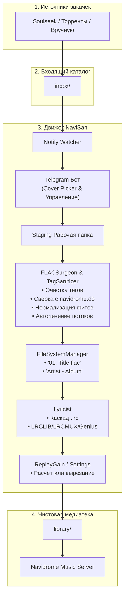

# NaviSan

**NaviSan** — автономный Telegram-бот и конвейер идеализации FLAC-библиотеки для личного сервера [Navidrome](https://www.navidrome.org/).

Бот автоматически подхватывает новые релизы из загрузок (Soulseek / торренты), очищает метаданные от мусора, нормализует артистов, подбирает Hi-Res обложки с ранжированием по качеству, находит или генерирует через нейросеть синхронизированные тексты песен (`.lrc`), восстанавливает повреждённые аудиопотоки FLAC, рассчитывает/вырезает ReplayGain и раскладывает всё по полочкам медиатеки.

---

## Основные возможности

### 1. Санитизация тегов и защита от мусора (TagSanitizer & FLACSurgeon)
* **Строгий белый список (Tag Whitelist):** удаляет рекламные комментарии рипперов, ссылки на трекеры, поля `ripped_by`, `encoder` и мусорные ID3-теги.
* **Канонизация артистов:** сверяет имена исполнителей с существующей базой Navidrome (`navidrome.db`).
* **Разделение фитов:** корректно разделяет составные строки (`feat.`, `ft.`, `x`, `&`, `,`) на индивидуальные теги `ARTIST`, сохраняя правильный `ALBUMARTIST`.
* **Защита ручного ввода:** ручные правки артистов и сложные псевдонимы (например, `Young P&H`) не разбиваются повторно автоматикой.
* **Умное слияние релизов (Smart Merge):** при докачке недостающих треков для уже существующего альбома NaviSan не создаёт дубликат с суффиксом «(2)», а аккуратно объединяет файлы в существующую папку, синхронизирует обложку и пересчитывает метаданные.
* **Синхронизация дат:** приводит дату треков в соответствие с датой релиза.
* **Нумерация треков по Genius:** если метаданные скачанного релиза не содержат номеров треков или перепутаны, бот восстанавливает правильный порядок через верифицированный треклист Genius.

### 2. Hi-Res обложки с сортировкой по качеству (Cover Picker)
* **Автоматический каскадный поиск:** ищет студийные обложки максимального разрешения в Apple Music, Deezer, Spotify и MusicBrainz.
* **Индикация разрешения и сортировка по качеству:** варианты обложек автоматически сортируются между источниками по убыванию реального физического разрешения (`3000×3000`, `1400×1400`, `600×600`).
* **Вшивание и sidecar:** вшивает выбранный арт в метаданные каждого FLAC и сохраняет оптимизированный `cover.jpg` в каталог альбома.
* **Команда `/cover [поиск]`:** позволяет в любой момент сменить обложку любого альбома в библиотеке.
* **Быстрый поиск в чате:** после ввода команды `/cover`, `/lyrics` или `/artist` достаточно просто отправить название альбома или трека в чат для мгновенного перехода к нему.

### 3. Тексты песен (.lrc караоке и plain)
* **Мульти-провайдер текстов:** каскадный поиск синхронизированных текстов `.lrc`:
  $$\text{LRCLIB (synced)} \longrightarrow \text{LRCMUX (KuGou/NetEase/YTMusic)} \longrightarrow \text{SyncedLyrics} \longrightarrow \text{Genius (plain)}$$
* **Учёт фитов при поиске:** бот учитывает приглашённых артистов (например, `Migos ft. Lil Uzi Vert`), гарантируя скачивание полноценного текста с куплетами всех участников.
* **Фильтрация релевантности:** строгая проверка совпадения артиста и названия защищает от случайного скачивания чужих текстов похожего названия.
* **3-уровневый интерфейс в Telegram:**
  * **Трек:** выбор источников (LRCLIB, LRCMUX, Genius, SyncedLyrics) и ручной ввод своего текста `.lrc` `[ ✏️ Свой текст ]`.
  * **Альбом:** статус текстов (🎤 / 📄 / ❌) и пакетная загрузка недостающих `[ 🌐 Найти ]`.
  * **Библиотека:** команда `/lyrics audit` — дашборд состояния текстов всей медиатеки с пакетным поиском недостающих текстов.

### 4. ReplayGain (EBU R128) и автолечение аудиопотоков FLAC
* **Переключатель режимов в `/settings`:**
  * `🟢 Рассчитывать` *(по умолчанию)*: расчёт `REPLAYGAIN_TRACK_GAIN` и `REPLAYGAIN_ALBUM_GAIN` через `metaflac` для комфортного прослушивания без скачков громкости.
  * `✂️ Вырезать`: теги ReplayGain вырезаются при обработке как мусор (для пользователей, предпочитающих чистое оригинальное звучание). Доступна кнопка `[ 🧹 Вырезать RG со всей библиотеки ]` для пакетной очистки медиатеки в 1 клик.
  * `⚪ Пропускать`: расчёт громкости пропускается для экономии времени и CPU.
* **Автолечение аудиопотоков FLAC (Stream Healing):**
  Строгие декодеры и плееры могут сбоить на повреждённых файлах с рассинхронизацией фреймов (`LOST_SYNC`). NaviSan автоматически лечит повреждённый FLAC-аудиопоток через `flac -d -F -c | flac -s -`, полностью сохраняя оригинальные теги и обложки.

### 5. Самообновление в 1 клик (`/update`)
* Бот умеет самостоятельно проверять наличие обновлений на GitHub (read-only через `git ls-remote` / GitHub API).
* При наличии обновлений выводит список новых коммитов и кнопку `[ 🚀 Обновить и перезапустить ]`.
* Выполняет `git pull origin main` и мгновенно перезапускает контейнер с сохранением контекста.
* Автоматическая очистка: служебные сообщения команды обновления удаляются через несколько секунд, сохраняя историю чата чистой.

### 6. Идеализация библиотеки (`/upgrade` и CLI `batch.py`)
* **Обычный режим:** быстро проверяет коллекцию и докачивает только то, чего не хватает (обложки, тексты, ReplayGain).
* **Smart Force режим (`/upgrade force` / `python batch.py --force`):**
  * Принудительно очищает теги всех треков от мусора.
  * Перекачивает свежие оригинальные Hi-Res обложки.
  * Пересчитывает ReplayGain для каждого релиза с нуля.
  * **Защита караоке от даунгрейда:** при обновлении текстов существующие синхронизированные (`🎤`) никогда не будут затёрты обычным текстом (`📄`).

### 7. Интерактивное управление артистами (`/artist`)
* Быстрый просмотр всех артистов и фитов по трекам релиза.
* Добавление и удаление артистов на конкретный трек прямо из Telegram.
* Смена `ALBUMARTIST` альбома и пакетная замена артиста во всех треках.

---

## Схема работы (Workflow)



---

## Команды Telegram-бота

Все команды доступны только владельцу (`NAVISAN_OWNER_ID`):

| Команда | Описание |
| :--- | :--- |
| `/settings` | Настройки бота: переключение режима ReplayGain (`🟢 Рассчитывать`, `✂️ Вырезать`, `⚪ Пропускать`) и кнопка пакетной очистки медиатеки |
| `/update` | Проверка обновлений на GitHub, вывод списка коммитов и установка в 1 клик с автоперезапуском контейнера |
| `/upgrade` | Меню идеализации всей библиотеки (кнопки **Обычный** или **Smart Force**) |
| `/upgrade force` | Быстрый запуск принудительной полной пересборки библиотеки |
| `/lyrics [поиск]` | Просмотр текстов альбома, карточки треков, смена источников (.lrc) |
| `/lyrics audit` | Дашборд аудита текстов по всей библиотеке (Синхронизированные / Обычные / Без текста) |
| `/cover [поиск]` | Интерактивный поиск и смена обложки альбома на Hi-Res (сортировка по разрешению) |
| `/artist [поиск]` | Просмотр и редактирование артистов альбома и треков |
| `/scan` | Ручное сканирование `inbox` и выбор релиза для обработки |
| `/process <папка>` | Принудительно отправить релиз из `inbox` в обработку |
| `/status` | Статус текущей сессии и очередей бота |
| `/cancel` | Отмена текущего ввода текста или ожидания действия |

> 💡 **Подсказка:** После вызова команд `/cover`, `/lyrics` или `/artist` можно просто написать название релиза текстом в чат — бот мгновенно найдёт и откроет его.

---

## Быстрый старт (Docker Compose)

Рекомендуемый способ запуска — Docker-контейнер рядом с Navidrome.

### 1. Клонирование репозитория
```bash
git clone https://github.com/arsendulaev/NaviSan.git /opt/navisan
cd /opt/navisan
```

### 2. Настройка конфигурации `.env`
Скопируй образец конфигурации:
```bash
cp .env.example .env
nano .env
```

Заполни параметры:
```ini
# Токен бота от @BotFather
TELEGRAM_BOT_TOKEN=123456789:ABCdefGHIjklMNOpqrSTUvwxYZ

# Твой числовой Telegram User ID
NAVISAN_OWNER_ID=123456789

# Пути внутри контейнера
NAVISAN_INBOX=/inbox
NAVISAN_STAGING=/staging
NAVISAN_LIBRARY=/library
NAVISAN_DB=/data/navidrome.db

# Поведение наблюдателя и конвейера
NAVISAN_SCAN_INTERVAL=5
NAVISAN_STABILITY_SECONDS=10
NAVISAN_DEFAULT_ACTION=manual
```

---

## Переменные окружения (.env)

Полный справочник настроек конфигурации:

| Переменная | По умолчанию | Описание |
| :--- | :--- | :--- |
| `TELEGRAM_BOT_TOKEN` | *(обязательно)* | Токен бота, полученный от [@BotFather](https://t.me/BotFather). |
| `NAVISAN_OWNER_ID` | *(обязательно)* | Твой числовой Telegram ID (узнать через [@userinfobot](https://t.me/userinfobot)). Доступ к боту имеет строго владелец. |
| `NAVISAN_INBOX` | `/inbox` | Каталог входящих релизов (куда скачивает Soulseek/slskd или торрент-клиент). |
| `NAVISAN_STAGING` | `/staging` | Временная рабочая директория бота для безопасной обработки без риска повредить файлы в хранилище. |
| `NAVISAN_LIBRARY` | `/library` | Чистовая музыкальная библиотека, которую сканирует сервер Navidrome. |
| `NAVISAN_DB` | `/data/navidrome.db` | Путь к базе SQLite Navidrome (монтируется строго `:ro`) для сверки канонических имён артистов. |
| `NAVISAN_SCAN_INTERVAL` | `5` | Интервал проверки входящей папки `inbox` (в секундах). |
| `NAVISAN_STABILITY_SECONDS` | `10` | **Таймер стабильности файлов (защита от недокачек):** релиз считается готовым к обработке только если его файлы НЕ перезаписывались в течение последних $N$ секунд. |
| `NAVISAN_DEFAULT_ACTION` | `manual` | **Режим обработки релиза:**<br>• `manual` — интерактивный: бот присылает варианты Hi-Res обложек в Telegram и ждёт выбора.<br>• `auto` — автоматический: бот берёт лучшую обложку и отправляет релиз на конвейер идеализации. |
| `NAVISAN_UPDATE_CHECK_INTERVAL` | `21600` *(6 часов)* | Интервал автоматической фоновой проверки обновлений на GitHub (в секундах). При выходе новой версии бот пришлёт уведомление с кнопкой обновления. |

### 3. Настройка томов в `docker-compose.yml`
Укажи реальные пути к твоим каталогам на сервере:
```yaml
services:
  navisan:
    build: .
    image: navisan:latest
    container_name: navisan
    user: "1000:1000"
    restart: unless-stopped
    env_file:
      - .env
    volumes:
      # Исходный код и репозиторий (для самообновления без пересборки)
      - ./:/app:rw
      # Папка загрузок torrent/slskd
      - /mnt/storage/downloads:/inbox:rw
      # Временная рабочая папка
      - /mnt/storage/staging:/staging:rw
      # Чистовая медиатека Navidrome
      - /mnt/storage/music:/library:rw
      # База данных Navidrome (только чтение)
      - /var/lib/navidrome/navidrome.db:/data/navidrome.db:ro
```

### 4. Запуск
```bash
docker compose up -d --build
```

Проверить логи работы:
```bash
docker compose logs -f navisan
```

Открой Telegram и напиши своему боту `/start`.

---

## Локальный запуск без Docker (Python venv)

Для запуска на локальной машине или сервере без контейнеров:

### Системные зависимости:
* Python 3.10+
* `flac` (для утилиты `metaflac` и восстановления аудиопотоков)
* `git` (для самообновления)

```bash
sudo apt install -y flac git
```

### Установка:
```bash
# 1. Создание окружения
python3 -m venv venv
source venv/bin/activate

# 2. Установка зависимостей
pip install --upgrade pip
pip install -r requirements.txt

# 3. Настройка конфигурации
cp .env.example .env
nano .env
```

В `.env` укажи локальные пути:
```ini
NAVISAN_INBOX=./inbox
NAVISAN_STAGING=./staging
NAVISAN_LIBRARY=./library
NAVISAN_DB=./navidrome.db
```

### Запуск Telegram-бота:
```bash
python bot.py
```

### Использование CLI-утилиты (без Telegram):
Для пакетной обработки каталога прямо из терминала:
```bash
# Мягкая идеализация библиотеки (только недостающие обложки, тексты и ReplayGain)
python batch.py

# Полная принудительная пересборка (Smart Force)
python batch.py --force

# Обработать релизы в Inbox без Telegram
python batch.py --target inbox
```

---

## Структура проекта

```text
Navisan/
├── batch.py             # CLI-утилита для пакетной обработки без Telegram
├── bot.py               # Telegram-бот, интерфейс управления и обработчики
├── covers.py            # Поиск, ранжирование и валидация Hi-Res обложек
├── lyricist.py          # Мульти-провайдер текстов песен (.lrc) и аудит медиатеки
├── pipeline.py          # Главный конвейер обработки, слияния и идеализации
├── renamer.py           # Каноническое именование треков и умное слияние папок
├── replaygain.py        # Расчёт/удаление ReplayGain (EBU R128) и лечение FLAC-потоков
├── sanitizer.py         # Санитизация тегов и нормализация артистов через navidrome.db
├── settings.py          # Управление персистентными настройками бота
├── surgeon.py           # Хирургическая очистка FLAC по whitelist и вшивка обложек
├── updater.py           # Механизм самообновления бота через Git в 1 клик
├── watcher.py           # Наблюдатель входящей папки (inotify/polling)
├── Dockerfile
├── docker-compose.yml
└── requirements.txt
```

---

## Безопасность

* **Long Polling:** бот соединяется с серверами Telegram самостоятельно. Никаких открытых входящих портов наружу не требуется.
* **Owner-Only:** бот полностью игнорирует сообщения от любых пользователей, чей ID не совпадает с `NAVISAN_OWNER_ID`.
* **Read-Only база:** файл `navidrome.db` монтируется строго в режиме только для чтения (`:ro`).
* **Bit-Perfect Audio:** аудиопотоки файлов FLAC никогда не пережимаются и не подвергаются транскодированию.
* **Чистый чат:** сервисные уведомления и команды автоматически удаляются из чата через настраиваемый интервал времени.

---

## Лицензия

GLWT License.
